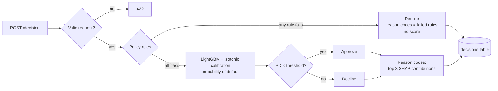
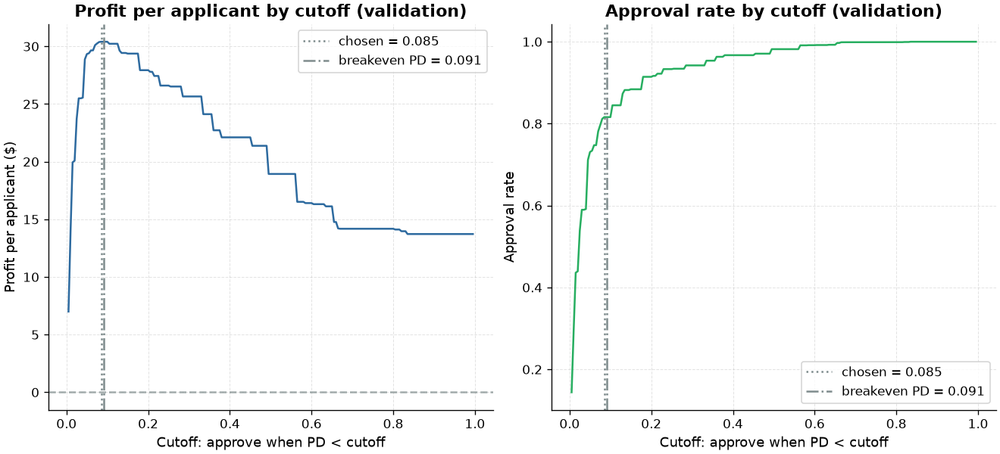

# Credit decision service

A small credit underwriting decision engine: hard policy rules, a calibrated risk model and a
profit-based approval threshold, served over FastAPI, with every decision logged to Postgres.

## The problem

A lender has to answer one question per application, fast and in a way it can explain later:
**approve or decline?** A good answer is not "the most accurate model". It is the decision that
makes money under explicit assumptions, respects non-negotiable policy, and leaves an audit trail:
which rules and which model version produced it, and why.

## How a decision is made



1. **Validation** (Pydantic) rejects impossible inputs, such as a negative age or unknown fields.
2. **Policy rules** (`policy.py`) run first. Any failed rule declines without scoring the
   applicant, and every failed rule is reported.
3. **The model** gives a calibrated probability of default (PD).
4. **The threshold** approves when `PD < 0.085`.
5. **Reason codes** are the three features that push this applicant's risk up the most, by SHAP
   value.
6. **Logging:** the request, the decision, the reason codes, `policy_version` and `model_version`
   are written to the `decisions` table before the response is returned.

Example:

```bash
curl -s -X POST localhost:8000/decision -H 'content-type: application/json' -d '{
  "revolving_utilization": 1.1, "age": 27, "past_due_30_59": 1, "debt_ratio": 0.8,
  "monthly_income": 2100, "open_credit_lines": 4, "past_due_90": 2,
  "real_estate_loans": 0, "past_due_60_89": 0, "dependents": 0}'
```
```json
{"decision": "decline", "probability_of_default": 0.563,
 "reason_codes": ["past_due_90", "revolving_utilization", "past_due_30_59"],
 "policy_version": "1.0.0", "model_version": "lgbm-202610042219"}
```

## Architecture

```
data/raw/cs-training.csv ─► etl.py ─► Postgres ─► train.py ─► artifacts/ (model, metadata)
                                                     └──────► reports/ (profit curve, metrics)

POST /decision ─► api.py ─► decision.py: policy.py ─► model PD ─► threshold ─► reason codes
                    └─► row in `decisions` (Postgres)
```

| Module | Responsibility |
|---|---|
| `config.py` | All settings from environment variables |
| `etl.py` | Kaggle CSV → cleaned `applicants` table |
| `features.py` | Single source of truth for feature names and order (training and serving) |
| `train.py` | Baseline vs LightGBM, calibration, metrics, profit curve, threshold, artifacts |
| `policy.py` | Versioned hard rules |
| `decision.py` | The decision flow and the loaded `RiskModel` |
| `schemas.py` | Request and response models |
| `db.py` | Table models, sessions, decision logging |
| `api.py` | FastAPI app: `POST /decision`, `GET /health` |
| `sql/analysis.sql` | Default rate by age, debt ratio and income band |

## Running it

Requires Python 3.11+ and Docker. On macOS, LightGBM also needs `brew install libomp`.

```bash
python3 -m venv .venv && .venv/bin/pip install -e ".[dev]"
# Download cs-training.csv from Kaggle's "Give Me Some Credit" into data/raw/
docker compose up -d postgres
.venv/bin/python -m credit.etl      # CSV -> `applicants` table
.venv/bin/python -m credit.train    # -> artifacts/ and reports/
docker compose up -d --build --wait # Postgres + API on :8000, returns once healthy
curl localhost:8000/health
```

Interactive docs are at `localhost:8000/docs`. Tests need neither Docker nor the dataset:

```bash
.venv/bin/pytest
.venv/bin/ruff check . && .venv/bin/ruff format --check .
```

## Results

Data: [Give Me Some Credit](https://www.kaggle.com/c/GiveMeSomeCredit) (Kaggle), 149,730
applicants after cleaning, 6.6% default rate. Split 60/20/20, stratified: train fits the models,
validation fits the calibrator and picks the threshold, and test is only for reporting.

| Model (test set) | AUC | KS | Brier |
|---|---|---|---|
| Logistic regression baseline | 0.805 | 0.466 | 0.0514 |
| **LightGBM + isotonic calibration** | **0.858** | **0.564** | **0.0495** |

At the chosen threshold, on test: **81.7% approval, 2.5% default rate among approved,
$29.54 profit per applicant.**



## Decisions and trade-offs

**Threshold by profit, not accuracy.** The illustrative unit economics are a $500 advance and a
10% fee: +$50 when repaid, −$500 on default (`UnitEconomics` in `train.py`, saved with the model).
The cutoff maximizes profit per applicant on validation. On ties it takes the lowest cutoff,
since the curve has flat stretches. As a control, the analytic breakeven PD,
`gain / (gain + loss) = 0.091`, is plotted next to it. The chosen 0.085 lands right beside it,
which is what a well-calibrated model should give. The curve is flat between ~0.05 and ~0.17, so
the decision is robust: what moves is approval vs risk, not profit. With a 5% fee the cutoff
would drop to 0.05, and with a 15% fee it would rise to 0.13.

**Calibration matters more than AUC here.** The threshold is a probability, so the score has to
be one. Isotonic regression on the validation set fixes calibration without changing the ranking.

**LightGBM over the baseline.** It adds +0.05 AUC and +0.10 KS, handles missing values natively
and gives exact per-applicant explanations (TreeSHAP). The baseline's metrics are saved with
every model to justify the extra complexity.

**Reason codes from LightGBM's built-in TreeSHAP** (`pred_contrib=True`). These are the same
values as `shap.TreeExplainer`, with no extra dependency at serving time. They are signed
contributions, so the codes name what raises risk, in the style of adverse-action reasons.

**Policy rules are few and labeled for what they are.**
- *Minimum age (18)* is a legal rule. The training data has no applicant under 21, so it cannot
  be justified by risk.
- *Zero or missing income* is an affordability rule. That segment actually defaults *less* than
  average (5.3% vs 6.6%), and the rule declines ~21% of applicants. It exists because repayment
  capacity cannot be verified, not because the segment is risky.
- Strong risk signals, such as any 90+ days late (41% default) or utilization above 100% (37%),
  are left to the model rather than hard-coded.

**Data cleaning keeps missingness.** Missing income and dependents stay as NULL, because
missingness is a signal. Rows with past-due counts of 96/98 (reporting codes, not counts) and an
age of 0 are dropped. Note that `DebtRatio` holds dollars, not a ratio, when income is missing;
the trees handle it, but it is documented in `sql/analysis.sql`.

**The model is mounted, not baked into the image.** `artifacts/` is mounted read-only into the
API container, so retraining does not need a rebuild, and `/health` reports which model is live.
The API fails fast at startup if the artifacts are missing.

**Log before responding.** If the audit row cannot be written, the client gets an error instead
of a decision nobody can trace.

**Tests without infrastructure.** Policy and decision tests use a fake model. API tests override
the session with in-memory SQLite and the model with the fake. One test trains a tiny real
LightGBM to check that the serving code reads what `train.py` writes. Table types stay portable
(JSON, not JSONB) for that reason.

## What I'd do next

- **A/B test policy changes**: route a share of traffic to a candidate policy or threshold and
  compare approval, losses and profit before rolling out. `policy_version` is already logged.
- **Reject inference**: the model only learns from applicants who were approved in the past.
- **Model registry and pinned dependencies**: versioned artifacts with their training data hash
  and library versions, instead of a mounted folder.
- **Monitoring**: feature drift (PSI) against the training sample, approval rate and PD
  distribution over time, from the `decisions` table.
- **CI**: lint, tests and a Docker build on every push.
- **Idempotency**: a client request ID, so a retried request does not create a second decision.
